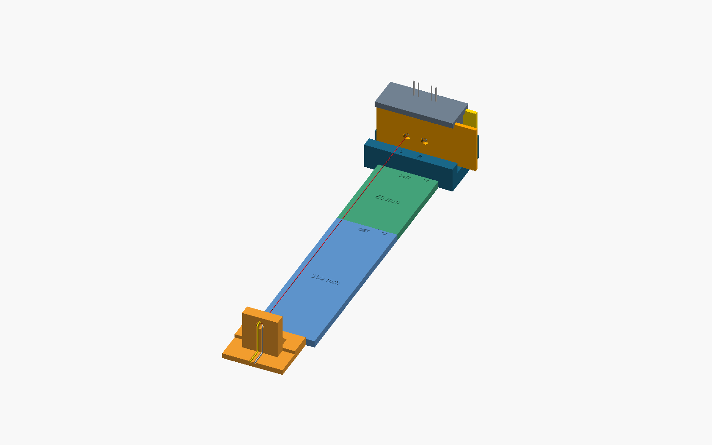

# Quantyra optical path spacers

**v1.0.0** provides 25, 50 and 100 mm added stop-spacing modules for the [keyed optical fixture v1.1.0](https://github.com/Quantyra/optical-fixture-system). Editable self-contained OpenSCAD and exact approved STL meshes. Patent pending. Version DOI pending publication; none is reserved in this candidate.

| Exact STL | Added stop spacing | Overall mesh dimensions X x Y x Z |
| --- | ---: | ---: |
| [25 mm](stl/extension_25mm.stl) | 25 mm | 34 x 32 x 4.4 mm |
| [50 mm](stl/extension_50mm.stl) | 50 mm | 34 x 57 x 4.4 mm |
| [100 mm](stl/extension_100mm.stl) | 100 mm | 34 x 107 x 4.4 mm |

The raised length labels mean distance between broad mating stop planes. They exclude 7 mm projecting tongues: they are neither total part length nor phase/refractive optical path. Nominal source height stays 20 mm. Stacking adds nominal axial stop spacing; it does not establish measured optical distance or precision.

CAD compatibility passed at the cradle-to-spacer, spacer-to-spacer and spacer-to-revised-stand interfaces. **Physical spacer fit is untested.** The operator reports practical fit of the printed revised stand and jig only. The V11 detector holder itself is unchanged. No spacer G-code was provided: slice these STLs fresh.

Read [assembly and printing](docs/print-and-assembly.md), [geometry checks](docs/geometry-checks.json) and [attribution](ATTRIBUTION.md). Export `cad/keyed_extensions.scad`, `part="extension"`, `L=25`, `50` or `100`; illustration modes show assembly, stack, underside, interface, receiver end and print layout. The included fixture/baseline CAD supports portable previews; get fixture print meshes and operator G-code from its own repository. Illustration hardware uses unmeasured proxies; the red line illustrates an axis.

The original fixture lift-off hood is incompatible with an extended rig. Use and independently check ambient control around the full supported rig; no cover-fit promise is made.

All included material uses [CERN-OHL-S-2.0](LICENSE). Source Location: https://github.com/Quantyra/optical-path-spacers. Open-source questions: info@quantyra.org. Separate commercial terms: info@qxcellerate.com. [Licensing guide](docs/licensing.md).

Run `python scripts/validate_release.py`. [Manifest](manifest.json), [checksums](SHA256SUMS), [citation](CITATION.cff), [Zenodo metadata](.zenodo.json). Publication identifiers will be added after verification.
