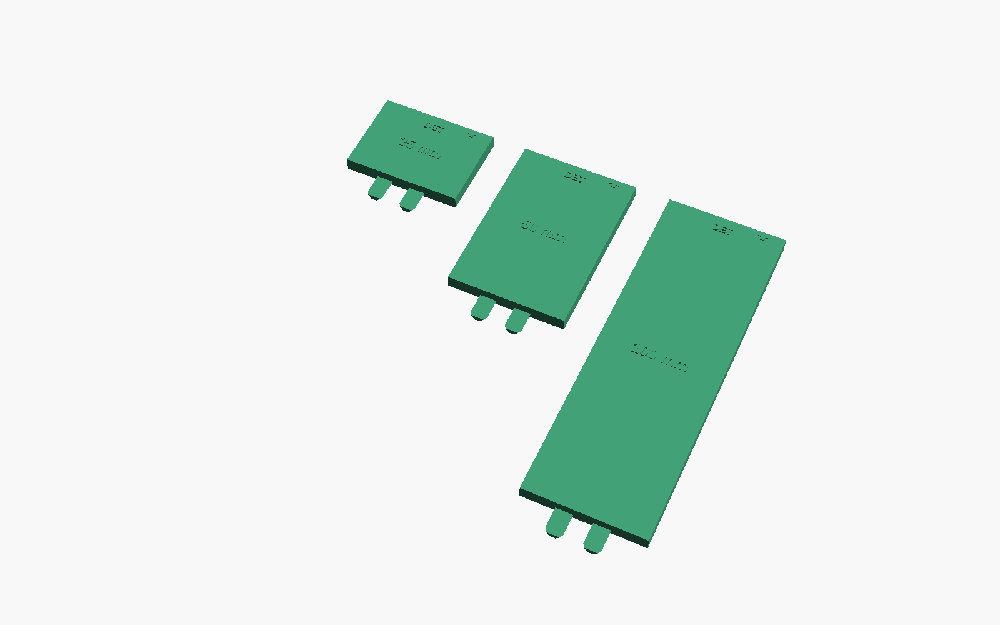
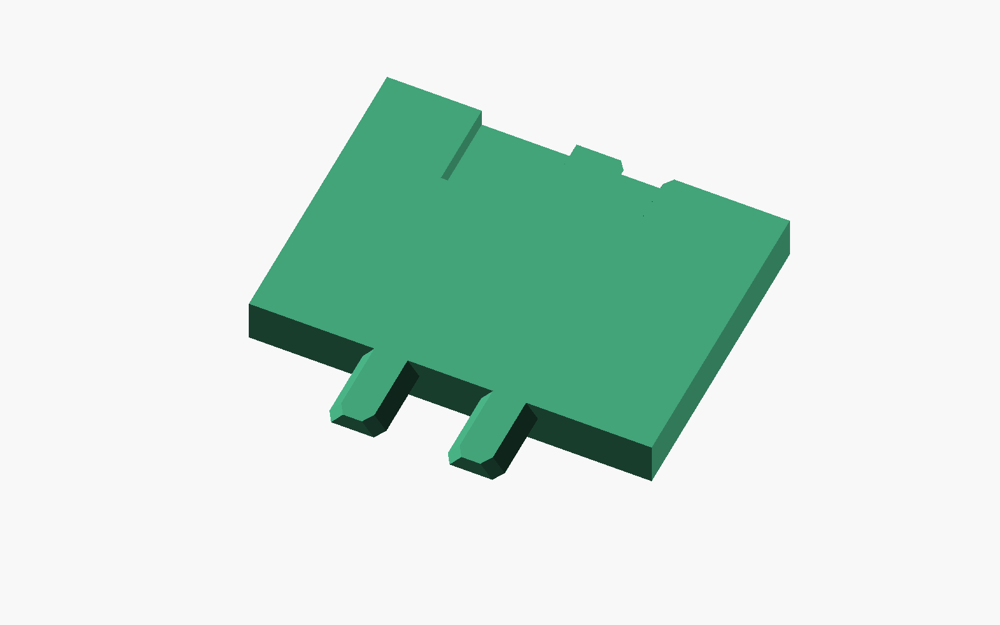
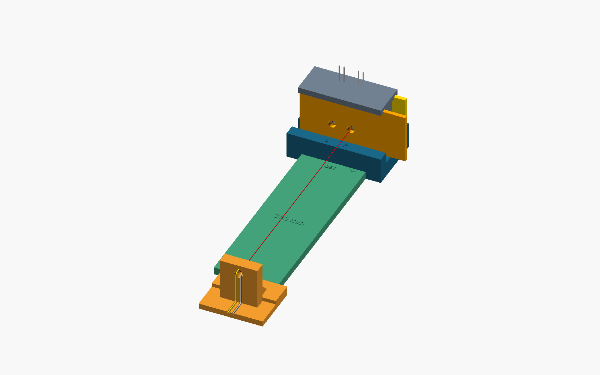

# Printing, interfaces and stacking

Slice the supplied 25/50/100 mm STL fresh for your printer and material. No spacer G-code is supplied. Print each module sole down, with tongues flat on the bed. Check pocket bridging and continuous roof fill, outward-growing tongue flanks, root integrity and the raised labels in the slicer. Nominal body thickness is 4 mm and labels reach 4.4 mm. At nominal 0.25 mm clearance, the receiver roof above the 1.65 mm ceiling is 2.35 mm; the loose relief bridge spans 8 mm. Keep the entire long sole flat on the bench. Inspect for bow, rocking, damage and trapped debris; fit gently before installing hardware.

Each module has a detector-facing female end (`DET` arrow) and a source-facing two-tongue male end. Looking from source toward detector, the receiver locates at X=-5 mm with a captured dovetail and clears the other incoming tongue in an 8 mm loose pocket at X=+5 mm. It has no central receiving socket. Both tongues engage together in the centered module position. At the outgoing end, two tongues remain at X=+/-5 mm (10 mm pitch). Each projects 7 mm and is 1.4 mm high, with 2.8 mm base and 4.8 mm top. Pockets are 7.4 mm deep: a 0.4 mm tip allowance remains at square stop contact. Flared mouths and narrowed tips ease entry; they do not latch.

1. Remove the original hood. Support cradle, every spacer and source stand on one firm flat bench. Leave lead slack.
2. Keep the cradle still. Set the first module sole down, `DET` toward the detector. Center its two receiving pockets on the cradle's two tongues and slide in +Y until broad stop faces seat squarely. Do not force.
3. For a chain, repeat with each next module centered, female end toward the preceding male end. Brace the preceding piece while inserting. All soles stay on the bench; modules extend end-to-end rather than vertically. Recheck every upstream stop.
4. Only the terminal source stand selects L/R: engage its central socket with the selected final tongue; its loose outer relief clears the unused tongue. Looking from source toward detector, L is X=-5 and R is X=+5. Extensions remain centered for either station.
5. To switch the terminal stand, hold the last module still, withdraw **7.2 mm straight in -Y**, translate **10 mm in X**, and reinsert +Y. Do not translate sideways while engaged, lift to switch or pull the leads. Recheck all stops after handling.
6. Dismantle source toward detector, withdrawing each receiving part at least 7.2 mm straight while bracing its predecessor. Do not use tongues as handles.

Module coordinates: detector stop Y=0, source stop Y=-L, sole Z=0; outgoing tips reach Y=-L-7. First module is placed at (0,-19,0); later modules at (0,-19-sum(previous L),0). With S=sum(L), terminal stand is at (s,-33-S,0), s=-5 or +5. This retains both terminal station positions without deliberate lateral shift through the chain.

Nominal horizontal clearance is 0.25 mm per flank. Spacer seated roof gap is 0.25 mm; revised stand roof gap is 0.6 mm with front apron 5 mm, pocket ceiling 2 mm and 3 mm roof. Neither gap is free lift: ideal centered sloped flanks govern approximately **0.35 mm lift**, satisfying `abs(dx) + lift/1.4 <= 0.25` in the straight section. Tilt/yaw, mouth flare, partial withdrawal and printing errors change behavior. There is no clamp, latch or preload. Play accumulates through every joint; yaw and imperfect stop seating can produce length-dependent alignment error. No physical stacking limit, perfect alignment or measured precision is established. Use the shortest practical chain and verify all stop contacts, sole support and actual optical alignment.

CAD compatibility passed for the revised stand and all three interface types. Physical spacer fit remains untested. Confirm every interface and both terminal stations gently on your prints, including full withdrawal travel and cable clearance. The operator's stand/jig fit report does not validate spacer printing or optical performance.

The original lift-off hood collides with the extended rig. Use independent ambient control, for example a sufficiently large opaque enclosure around the complete supported assembly. Check clearance at both stations and during withdrawal, preserve ventilation and cable slack, and measure dark/background response. No cover fit, attenuation or light-leak result is promised. Follow the separate source and detector safety instructions.

For matching raised lettering, use OpenSCAD with Liberation Sans Bold available. The supplied exact STLs remain the print reference if another font environment changes text outlines. CAD export equality here was checked in the release build environment; no fonts or slicer are installed by the validator.
